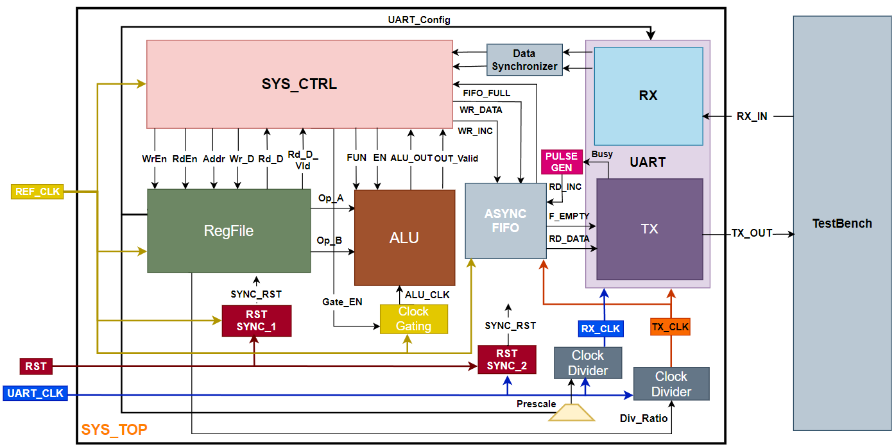

# UART Command Processing System

**A dual-clock-domain, UART-controlled register-file and ALU processing system, taken from RTL through synthesis, DFT, formal equivalence, place & route and gate-level simulation.**

A host sends command frames over a UART link; the system decodes them, reads/writes an internal register file or executes an ALU operation, and returns the result over UART. The design spans two asynchronous clock domains (50 MHz system logic and a 3.6864 MHz UART domain) and is implemented end to end in a 0.13 µm standard-cell flow.

---

## Table of Contents

1. [Key Features](#key-features)
2. [Architecture](#architecture)
3. [Clock Domains and CDC](#clock-domains-and-cdc)
4. [Command Protocol](#command-protocol)
5. [Repository Structure](#repository-structure)
6. [Tools and Prerequisites](#tools-and-prerequisites)
7. [Setup](#setup)
8. [How to Run](#how-to-run)
9. [Implementation Results](#implementation-results)
10. [Status and Known Issues](#status-and-known-issues)
11. [Documentation](#documentation)
12. [License](#license)

---

## Key Features

- **UART command interface**: full-duplex UART (8 data bits, configurable parity, 1 stop bit) with parity-error and framing-error flags.
- **Four command types**: register-file write, register-file read, ALU operation with operands, ALU operation using the operands already stored in the register file.
- **ALU**: 15 operations (arithmetic, bitwise logic, comparison, shift) with a 16-bit result returned as two UART frames.
- **Runtime-configurable UART**: parity enable/type, prescale and TX divider ratio are programmable through the register file.
- **Multi-clock-domain crossing (CDC)** between 50 MHz system logic and 3.6864 MHz UART logic, using an **Asynchronous FIFO** (Gray-coded pointers, 2-FF synchronizers) and a **Data Synchronizer** (enable-pulse handshake), plus per-domain reset synchronizers.
- **Dynamic power reduction** via **operand/execution clock gating on the ALU when idle** (integrated clock-gating cell, with a latch-based RTL fallback for simulation).
- **Scan-based DFT**: multiplexed-flop scan insertion with 4 scan chains and FUNC / SCAN / CAPTURE constraint modes.
- **Formal equivalence checking** (RTL vs. post-synthesis, RTL vs. post-DFT).
- **Physical implementation**: floorplan, placement, clock-tree synthesis, routing, finishing, GDSII export.
- **Verification**: class-based SystemVerilog testbench with one directed test per command, block-level testbenches, structural CDC lint, and gate-level simulation of the post-layout netlist.

---

## Architecture



### Blocks

| Block | Domain | Role |
|---|---|---|
| `SYS_CTRL` | REF_CLK | Command decoder FSM: sequences register accesses, ALU launches, clock-gate enable and TX data push |
| `RegFile` | REF_CLK | 16 × 8-bit register file; REG0/REG1 = ALU operands, REG2 = UART config, REG3 = divider ratio |
| `ALU` | gated REF_CLK | 8-bit operands, 16-bit result, registered output with valid flag |
| `CLK_GATE` | REF_CLK | Clock gating for the ALU (`USE_ICG=1`: library ICG cell; `USE_ICG=0`: latch + AND for RTL simulation) |
| `UART_RX` / `UART_TX` | RX_CLK / TX_CLK | Serial receiver (oversampled, start/parity/stop checking) and transmitter (FIFO-fed) |
| `CLOCK_DIVIDER` | UART_CLK | Generates TX and RX clocks from UART_CLK; `DIV_MUX` derives the RX ratio from TX ratio and prescale |
| `DATA_SYNC` | REF_CLK | Synchronizes the RX parallel byte into the system domain using a synchronized enable pulse |
| `ASYNC_FIFO` | REF_CLK to TX_CLK | 8-deep × 8-bit dual-clock FIFO (Gray-coded pointers, 2-FF synchronizers) |
| `PULSE_GEN` | TX_CLK | Converts the UART_TX busy level into a FIFO read pulse |
| `RST_SYNC` | per domain | Asynchronous assert, synchronous de-assert reset synchronizer (one per domain) |

Two top-level variants are provided in `System_Design/SYS_TOP/rtl/`:

- `SYS_TOP.sv` defines module **`sys_top`**, the functional top (used for synthesis and lint).
- `SYS_TOP_dft.sv` defines module **`SYS_TOP`**, the DFT-ready top (adds `scan_clk`, `scan_rst`, `test_mode`, `SE`, `SI[3:0]`, `SO[3:0]`, test-mode clock/reset muxing). This is the top used for DFT, place & route, and gate-level simulation.

---

## Clock Domains and CDC

| Clock | Frequency | Period | Use |
|---|---|---|---|
| `REF_CLK` | 50 MHz | 20 ns | RegFile, SYS_CTRL, ALU (gated), FIFO write side |
| `UART_CLK` | 3.6864 MHz | 271.267 ns | Source for the TX/RX clock dividers |
| `TX_CLK` | `UART_CLK / div_ratio` (default 3.6864 MHz / 32 = 115.2 kHz) | | UART_TX, FIFO read side, PULSE_GEN |
| `RX_CLK` | `TX_CLK × prescale` (default `UART_CLK / 1`, 32× oversampling) | | UART_RX |

With the default configuration the link runs at **115200 baud**, parity enabled, even parity, prescale 32.

**Clock-domain crossings**

| Crossing | Direction | Mechanism |
|---|---|---|
| UART_RX data to SYS_CTRL | UART domain to REF_CLK (slow to fast) | `DATA_SYNC`: multi-flop synchronized enable, edge-detected pulse qualifies the captured data bus |
| SYS_CTRL data to UART_TX | REF_CLK to TX_CLK (fast to slow) | `ASYNC_FIFO`: binary-to-Gray pointer conversion (`b2g`), 2-FF pointer synchronizers, full/empty flag generation |
| Resets | external async to each domain | `RST_SYNC` per domain |

Structural CDC analysis was run with SpyGlass (goals `cdc/cdc_verify` and `cdc/cdc_verify_struct`). Warnings about FIFO pointers that the tool cannot recognize as Gray-coded are waived with documented justification.

---

## Command Protocol

Every frame is a UART frame: 1 start bit, 8 data bits (LSB first), 1 parity bit (when enabled), 1 stop bit. Parity enable / type are held in `REG2[0]` / `REG2[1]`.

| Command | Opcode | Frames sent to the system | Response |
|---|---|---|---|
| Register-file write | `0xAA` | `0xAA`, address, data | none |
| Register-file read | `0xBB` | `0xBB`, address | 1 frame: register value |
| ALU operation with operands | `0xCC` | `0xCC`, operand A, operand B, ALU function | 2 frames: result LSB, result MSB |
| ALU operation without operands | `0xDD` | `0xDD`, ALU function | 2 frames: result LSB, result MSB (uses the current REG0/REG1) |

**Register map**

| Address | Register | Contents |
|---|---|---|
| `0x0` | REG0 | ALU operand A |
| `0x1` | REG1 | ALU operand B |
| `0x2` | REG2 | UART config: `[0]` parity enable (default 1), `[1]` parity type (default 0 = even), `[7:2]` prescale (default 32) |
| `0x3` | REG3 | TX clock divider ratio (default 32) |
| `0x4`–`0xF` | general | General-purpose storage |

**ALU functions** (`ALU_FUN[3:0]`)

| Code | Operation | Code | Operation |
|---|---|---|---|
| `0000` | A + B | `1000` | A ^ B |
| `0001` | A − B | `1001` | ~(A ^ B) |
| `0010` | A × B | `1010` | A == B |
| `0011` | A / B | `1011` | A > B |
| `0100` | A & B | `1100` | A < B |
| `0101` | A \| B | `1101` | A >> 1 |
| `0110` | ~(A & B) | `1110` | A << 1 |
| `0111` | ~(A \| B) | other | result = 0 |

---

## Repository Structure

```
uart-command-processing-system/
├── Specifications/            System and UART block specifications (PDF, diagrams)
├── System_Design/             RTL, block-level testbenches, simulation scripts
│   ├── ALU/  CLK_GATE/  CLOCK_DIVIDER/  DATA_SYNC/  DIV_MUX/  FIFO/
│   ├── PULSE_GEN/  RST_SYNC/  RegFile/  SYS_CTRL/
│   ├── UART/ (UART_RX, UART_TX, UART_TOP)
│   └── SYS_TOP/               Top-level RTL (rtl/), system testbench (tb/), simulation (sim/)
├── lint/                      SpyGlass CDC project, source list, SGDC constraints
├── Backend/
│   ├── Synthesis/             Design Compiler flow (run_syn.sh, syn_script.tcl, cons.tcl)
│   ├── DFT/                   Scan insertion flow (run_dft.sh, dft_script.tcl, cons*.tcl)
│   └── Formality/             Equivalence checks: post-syn/ and post-dft/
├── System_pnr/
│   ├── pnr/                   Place & route scripts and outputs (Cadence Encounter)
│   └── gls/                   Gate-level simulation (run.do, tb.sv, netlist, SDF)
├── std_cells/                 Standard-cell libraries (NOT distributed, see below)
├── System_Test_Cases.pdf      Test-case summary with simulation evidence
└── README.md
```

Each block directory follows the same pattern: `rtl/` (design), `tb/` (testbench), `sim/` (`run.do`, `wave.do`).

---

## Tools and Prerequisites

| Stage | Tool (version seen in the included logs) |
|---|---|
| RTL / gate-level simulation | Mentor ModelSim / Questa Sim (SystemVerilog support required) |
| CDC lint | Synopsys SpyGlass 2016 |
| Synthesis, DFT | Synopsys Design Compiler O-2018.06-SP1 (`dc_shell`) |
| Equivalence checking | Synopsys Formality (`fm_shell`) |
| Place & route | Cadence First Encounter / Encounter 08.10 |
| Technology | TSMC 0.13 µm (CL013G) RVT standard cells: SS 1.08 V 125 °C, TT 1.2 V 25 °C, FF 1.32 V −40 °C |


Before running any backend or gate-level flow, place the following under `std_cells/`:

```
std_cells/
├── scmetro_tsmc_cl013g_rvt_ss_1p08v_125c.db / .lib
├── scmetro_tsmc_cl013g_rvt_tt_1p2v_25c.db   / .lib
├── scmetro_tsmc_cl013g_rvt_ff_1p32v_m40c.db / .lib
├── tsmc13_m.v                 (Verilog simulation models)
├── libs/                      (.lib files, used by PnR)
├── lef/                       (tsmc13fsg_7lm_tech.lef, tsmc13_m_macros.lef)
└── captables/                 (tsmc13fsg.capTbl)
```

---

## Setup

```bash
git clone https://github.com/<USER>/uart-command-processing-system.git
cd uart-command-processing-system

# Home directory of the project. The backend and PnR scripts resolve their paths from it.
export PROJECT_HOME=$(pwd)
```

`PROJECT_HOME` must be exported in the shell from which you launch the tools. Every command below is run from the directory shown in its heading.

---

## How to Run

### 1. System-level RTL simulation (testbench)

```bash
cd $PROJECT_HOME/System_Design/SYS_TOP/sim
vsim -do run.do
```

`run.do` creates the work library, compiles all block RTL plus `SYS_TOP/tb/tb.sv`, elaborates `tb`, loads `wave.do` and runs to completion. The testbench drives UART frames into `SYS_TOP`, monitors `tx_out`, and exercises one directed test per command (see `System_Test_Cases.pdf`). The clock gate is instantiated with `USE_ICG=0` so no standard-cell models are needed for RTL simulation.

### 2. Block-level simulation

```bash
cd $PROJECT_HOME/System_Design/<BLOCK>/sim      # ALU, CLK_GATE, CLOCK_DIVIDER, DATA_SYNC, FIFO, RST_SYNC, RegFile, UART/UART_RX, UART/UART_TX
vsim -do run.do
```

### 3. CDC lint (SpyGlass)

Open `lint/sys_lint.prj` in SpyGlass (source list: `lint/sys.lst`, constraints: `lint/system.sgdc`) and run the `cdc/cdc_verify` and `cdc/cdc_verify_struct` goals.

### 4. Logic synthesis

```bash
cd $PROJECT_HOME/Backend/Synthesis
bash run_syn.sh
```

Reads the RTL listed in `system.lst`, applies `cons.tcl`, compiles `sys_top`, and writes the netlist/SDF/SDC to `netlists/`, `sdf/`, `sdc/` and reports (area, power, timing, clocks, constraints) to `reports/`. Log: `log/syn.log`.

### 5. DFT (scan insertion)

```bash
cd $PROJECT_HOME/Backend/DFT
bash run_dft.sh
```

Synthesizes `SYS_TOP` (the DFT-ready top) with scan (`compile -scan`), inserts 4 multiplexed-flop scan chains, and writes the scan netlist, SDF, per-mode SDC and reports. The constraint mode is selected by the `MODE` variable at the top of `dft_script.tcl` (`FUNC`, `SCAN` or `CAPTURE`). The repository already contains the SDC files generated for all three modes (`sdc/SYS_TOP_func.sdc`, `SYS_TOP_scan.sdc`, `SYS_TOP_capture.sdc`). Log: `log/dft.log`.

### 6. Formal equivalence checking

```bash
# RTL vs. post-synthesis netlist
cd $PROJECT_HOME/Backend/Formality/post-syn
sh run_syn_fm.tcl

# RTL vs. post-DFT netlist (scan ports and test_mode/SE tied off)
cd $PROJECT_HOME/Backend/Formality/post-dft
sh run_dft_fm.tcl
```

`run_syn_fm.tcl` and `run_dft_fm.tcl` are small launcher scripts (despite the extension, they contain shell commands) that create `logs/` and `reports/` and call `fm_shell -f syn_fm_script.tcl` / `dft_fm_script.tcl`. Both flows use the SVF files produced by synthesis/DFT and write passing/failing/aborted/unverified point reports to `reports/`. The post-DFT flow reads `Backend/DFT/netlists/SYS_TOP.ddc`, so run the DFT step first.

### 7. Place & route

```bash
cd $PROJECT_HOME/System_pnr/pnr
encounter          # launch the Encounter console in this directory
```

Source the stage scripts from the Encounter console in order:

```tcl
source des_import.tcl      ;# import post-DFT netlist, libraries, LEFs, MMMC corners
source floorplan.tcl       ;# floorplan (NUM_SCAN_CHAINS = 4)
source placement.tcl       ;# placement, tie cells, power-net connection
source cts.tcl             ;# clock-tree synthesis (Clock.ctstch spec)
source routing.tcl         ;# NanoRoute
source chip_finish.tcl     ;# fillers and final checks
source outputs_gen.tcl     ;# netlist, SDF, SPEF, power report, GDSII
```

Outputs are written to `export/` (netlists, SDF, GDSII) and `report/`. Copy the exported `SYS_TOP.v` and `SYS_TOP.sdf` into `System_pnr/gls/` to run gate-level simulation (the repository ships the copies used for the included results).

### 8. Gate-level simulation (post-layout)

```bash
cd $PROJECT_HOME/System_pnr/gls
vsim -do run.do
```

`run.do` compiles the standard-cell models (`std_cells/tsmc13_m.v`), the post-PnR netlist `SYS_TOP.v` and `tb.sv`, then simulates with the max-delay SDF back-annotated onto the DUT (`vsim -sdfmax /tb/dft_sel/DUT=SYS_TOP.sdf`). The same four commands are exercised as in the RTL testbench. A waveform dump is written to `VCD/system.vcd`.

---

## Implementation Results

| Stage | Result |
|---|---|
| Synthesis (`sys_top`) | 1944 cells (380 sequential), total cell area 21,984 µm², no violated constraints reported (`reports/constraints.rpt`) |
| Post-synthesis power estimate | 0.225 mW total (SS 1.08 V / 125 °C, low-effort propagated activity; indicative only) |
| DFT (`SYS_TOP`) | 4 scan chains, 364 sequential cells, total cell area 24,679 µm², estimated test coverage 99.59 % (`dft_drc -coverage_estimate`) |
| Formality | RTL vs. post-synthesis: verification succeeded. RTL vs. post-DFT: verification succeeded (scan-out ports excluded; `test_mode` and `SE` constrained to 0) |
| Place & route | Floorplan 240.47 µm × 160.47 µm; `verifyGeometry`: no DRC violations; `verifyConnectivity`: no problems; `verifyProcessAntenna`: no violations; |
| System tests | 4 / 4 directed tests pass in RTL simulation (`System_Test_Cases.pdf`) |

### Power methodology scope

This project implements power-reduction technique: **dynamic power reduction through operand/execution clock gating of the ALU while it is idle** (the ALU clock only toggles when `SYS_CTRL` launches an operation).

---


## Documentation

- `Specifications/Final_System.pdf`: system-level specification and block interfaces
- `Specifications/UART/`: UART TX / RX / top specifications, block diagrams and FSM diagram
- `System_Test_Cases.pdf`: one test case per command with waveform evidence
- `System_pnr/gls/testcases.pdf`: gate-level simulation test cases

---

## License

See [LICENSE](LICENSE).

## Author

Kirllos Atef
